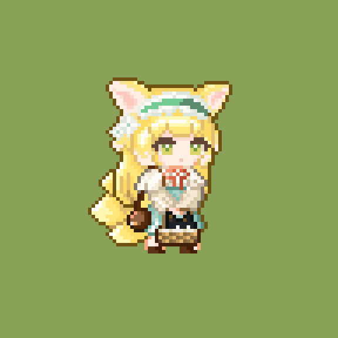
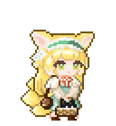
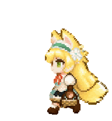
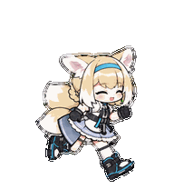
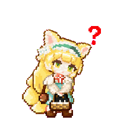
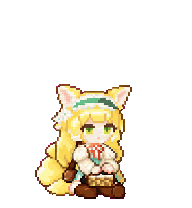
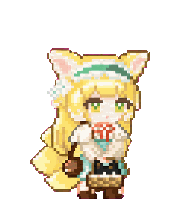
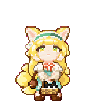

<div align="center">

# 铃兰 · Suzuran

一只以铃兰像素 GIF 为灵感制作的 Codex 桌宠。


**像素风格 · 原始 GIF 工作动作 · 坐地等待 · 悬停疑问**

[动作预览](#动作预览) · [安装使用](#安装使用) · [文件说明](#文件说明)

</div>

## 关于铃兰

金色长发、柔软的兽耳、绿白花饰，以及抱在身前的小篮子——让铃兰以像素风的形象陪伴工作。

工作时，她沿用原始 GIF 的轻微摆动与眨眼；等待时，她会坐在地上抱着篮子；鼠标悬停到身上时，她会向右轻轻歪头，右上方出现红色问号。

## 设计灵感

外观与工作动作来自用户提供的铃兰像素 GIF。下面展示原始素材与去除背景后的桌宠动作：

| 原始像素 GIF | 桌宠工作动作 |
| :---: | :---: |
|  |  |

原始 GIF 包含 **3 帧**，每帧 **180 毫秒**。工作动作直接提取全部三个姿态，去除背景后以最近邻缩放保留像素边缘，按 `0 → 0 → 1 → 1 → 2 → 2` 的顺序适配工作状态的六个帧位。

其他动作以这套形象为参考制作。GIF 预览用于展示动作，桌宠中的实际播放速度由客户端控制。

## 动作预览

| 动作 | 表现 | GIF 预览 |
| --- | --- | :---: |
| 待机 | 轻微呼吸与眨眼，安静陪伴 |  |
| 工作 | 保留原始 GIF 的三个姿态，轻微摆动与眨眼 |  |
| 向左移动 | 朝画面左侧迈步 |  |
| 向右移动 | 朝画面右侧迈步 |  |
| 挥手 | 用空闲的手打招呼 |  |
| 悬停疑问 | 头部向右轻轻倾斜，右上方出现红色问号 |  |
| 失败 | 低落的表情与恢复动作 |  |
| 等待 | 坐在地上，抱着篮子耐心等待 |  |
| 检查 | 专注查看结果 |  |
| 视线 | 顺时针排列的 16 个视线方向 |  |

悬停疑问动作使用客户端原有的 `jumping` 动作槽，因此预览文件仍命名为 `jumping.gif`，实际内容已改为歪头与红色问号。

## 安装使用

1. 下载本仓库中的 `pet.json` 和 `spritesheet.webp`。
2. 新建本地桌宠目录 `~/.codex/pets/Suzuran/`，将两个文件放入同一目录。
3. 在客户端的桌宠设置中刷新列表，选择 **铃兰**。

Windows 对应目录为：

```text
C:\Users\你的用户名\.codex\pets\Suzuran\
├── pet.json
└── spritesheet.webp
```

如果铃兰已由 Pets 云端库管理，需要通过 Pets 插件更新图集；仅替换本地文件不会更新云端版本。

## 文件说明

GitHub 仓库包含安装包和展示预览：

```text
Suzuran/
├── README.md
├── pet.json                 # 名称、描述及图集版本
├── spritesheet.webp         # 透明动画图集
└── assets/
    ├── inspiration.gif      # 原始像素 GIF
    ├── idle.gif             # 待机
    ├── working.gif          # 工作
    ├── running-left.gif     # 向左移动
    ├── running-right.gif    # 向右移动
    ├── waving.gif           # 挥手
    ├── jumping.gif          # 悬停疑问
    ├── failed.gif           # 失败
    ├── waiting.gif          # 坐地等待
    ├── review.gif           # 检查
    └── look-loop.gif        # 视线循环
```

安装只需要 `pet.json` 与 `spritesheet.webp`。`assets/` 用于 README 展示，上传 GitHub 时请一并保留，避免 GIF 链接失效。

## 图集规格

| 项目 | 规格 |
| --- | --- |
| 图集版本 | `spriteVersionNumber: 2` |
| 文件格式 | 透明 WebP |
| 图集尺寸 | 1536 × 2288 像素 |
| 排列 | 8 列 × 11 行 |
| 单帧尺寸 | 192 × 208 像素 |
| 状态动作 | 9 组 |
| 视线方向 | 16 个，间隔 22.5° |

## 制作说明

原始工作动作直接从像素 GIF 提取；补充动作使用 Codex、hatch-pet 与 imagegen 制作。素材经帧提取、最近邻缩放、透明背景处理及动作检查后组装为图集。

当前版本包含坐地等待和悬停疑问两项动作更新。
