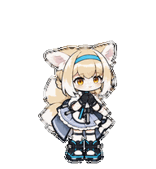

<div align="center">

# 铃兰 · Suzuran

一只安静陪伴你工作的 Codex 桌宠。



**安静待机 · 低头思考 · 16 个视线方向**

</div>

## 设计灵感

这个项目的设计灵感来自铃兰的原始 GIF：浅金色头发、蓝色发带、兽耳与蓬松尾巴，搭配蓝白裙装，呈现出温柔、轻快的 Q 版形象。

最初希望在 Codex 工作时，复现 GIF 中左右摇摆的动作。原始 GIF 包含 **19 帧**；当前采用的 Codex v2 桌宠格式中，工作状态 `running` 使用 **6 帧**，无法在这一状态下直接播放完整的原生 19 帧动画。

因此，最终为铃兰设计了新的 **“低头思考”** 动作：微微低头，轻轻眨眼，再回到原来的姿势。用小幅、安静的变化表达“正在认真工作”，也更适合长时间陪伴。

| 原始 GIF · 设计灵感 | 新工作动作 · 低头思考 |
| :---: | :---: |
|  |  |
| 原始 19 帧左右摇摆动画 | 适配工作状态的 6 帧循环 |

> 19 帧原始 GIF 保留在仓库中作为设计参考；实际桌宠使用新制作的动画图集。

## 动作与状态

每个预览均为循环 GIF。左右移动分别展示，视线预览按顺序展示全部 16 个方向。

| 状态 | 表现 | 动画预览 |
| --- | --- | :---: |
| 待机 | 安静陪伴，轻微呼吸与表情变化 |  |
| 工作 | 微微低头思考，眨眼后回正 |  |
| 向左移动 | 向左移动的循环动作 |  |
| 向右移动 | 向右移动的循环动作 |  |
| 挥手 | 打招呼 |  |
| 跳跃 | 起跳并回到原位 |  |
| 失败 | 表达任务受阻或失败 |  |
| 等待 | 等待确认或进一步指令 |  |
| 检查 | 专注检查完成的结果 |  |
| 视线 | 16 个方向的连续视线姿势 |  |

## 成品文件

```text
Suzuran/
├── README.md
├── pet.json                 # 桌宠信息与图集配置
├── spritesheet.webp         # 最终动画图集
└── assets/
    ├── inspiration.gif      # 原始 19 帧 GIF
    ├── thinking.gif         # 新工作动作预览
    ├── idle.gif             # 待机
    ├── running-left.gif     # 向左移动
    ├── running-right.gif    # 向右移动
    ├── waving.gif           # 挥手
    ├── jumping.gif          # 跳跃
    ├── failed.gif           # 失败
    ├── waiting.gif          # 等待
    ├── review.gif           # 检查
    └── look-loop.gif        # 16 个方向的视线循环
```

图集采用 `spriteVersionNumber: 2`，尺寸为 **1536 × 2288**，包含 **8 列 × 11 行**，单帧尺寸为 **192 × 208**，背景透明。

如果上传完整制作目录，`references/`、`decoded/`、`frames/`、`qa/`、`final/` 和 `tools/` 中还保留了参考素材、生成姿势、抽帧、检查报告与制作脚本。

## 使用说明

`pet.json` 与 `spritesheet.webp` 需要放在同一目录中，组成桌宠安装包。

本地自定义桌宠目录为 `~/.codex/pets/Suzuran/`。对于已迁移到 Pets 云端库的桌宠，更新动作还需要通过 Pets 插件上传新版图集；只替换本地文件不会更新当前云端桌宠。

## 制作

使用 Codex、`hatch-pet` 与 imagegen 制作姿势，通过抽帧、统一尺寸、透明边缘处理与图集验证完成打包。最终工作动作经过独立视觉检查，并已同步至 Pets 云端版本。
